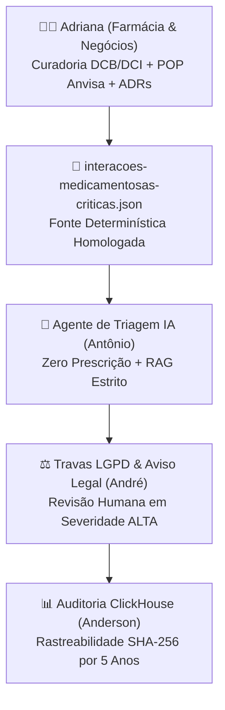

# 👩‍⚕️ Strategy & HealthTech — Estratégia de Mercado, Governança Sanitária (Anvisa) & Bases Clínicas
**Líder Responsável:** 👤 **Adriana — Diretora de Estratégia de Negócios, Produto & Farmácia**

> [!IMPORTANT]
> **Missão do Repositório:** Conectar a visão empreendedora de mercado e o rigor científico/regulatório da **Farmácia (Anvisa, DCB/DCI e Boas Práticas)** diretamente ao motor de Inteligência Artificial do **Antônio**, à governança jurídica do **André** e à infraestrutura analítica do **Anderson**.

---

## 🚀 1. O Papel da Diretoria de Empreendedorismo e Farmácia no GitHub

Muitas startups de tecnologia falham porque constroem códigos sofisticados desconectados da dor real do cliente B2B ou porque violam normas regulatórias críticas (como as Resoluções da Diretoria Colegiada — RDCs da **Anvisa**).

Na **Fratuci Labs**, a diretoria liderada pela **Adriana** utiliza o GitHub como **Plataforma de Gestão Ágil, Compliance Sanitário (*Compliance as Code*) e Ciência Aberta (*Open Science*)**:

1. **Decisões Estratégicas de Negócio (`business-adrs/`):**
   - Nenhuma linha de código é escrita sem uma **ADR (*Architecture & Business Decision Record*)** que comprove o tamanho do mercado, o modelo de receita recorrente (SaaS B2B) e o custo de aquisição.
2. **Conformidade Sanitária Versionada (`regulatorio-anvisa/`):**
   - Os **Procedimentos Operacionais Padrão (POPs)** exigidos pela vigilância sanitária e pela RDC Anvisa nº 657/2022 (*Software as a Medical Device* / Sistemas Computadorizados) são versionados em Git, permitindo que qualquer auditor verifique quem aprovou cada regra clínica e em qual data.
3. **Curadoria Farmacológica para IA (`pharma-data/`):**
   - Para evitar que os modelos de IA do **Antônio** sofram "alucinações" médicas, a **Adriana** mantém dicionários clínicos determinísticos em JSON utilizando a **Denominação Comum Brasileira (DCB)** e a **Denominação Comum Internacional (DCI)**.
4. **Integração Direta via Gemini App (`historico-gemini/`):**
   - A **Adriana** realiza estudos de viabilidade e revisões farmacológicas conversando com o **Google Gemini** e publica os artefatos diretamente neste repositório através do webhook automático construído pelo **Antônio** e hospedado pelo **Anderson**.

---

## 📂 2. Estrutura do Repositório

| Arquivo | Descrição Executiva | Aplicação Prática |
| :--- | :--- | :--- |
| [`business-adrs/ADR-001-selecao-verticais-mercado.md`](./business-adrs/ADR-001-selecao-verticais-mercado.md) | Análise comparativa das **3 Verticais de Mercado** (HealthTech, Data/Stream Ops e LogTech), modelos de monetização B2B e matriz de priorização. | Guia o Roadmap de Produto da família. |
| [`regulatorio-anvisa/POP-001-validacao-sistemas-computadorizados.md`](./regulatorio-anvisa/POP-001-validacao-sistemas-computadorizados.md) | **POP-001:** Procedimento Operacional Padrão para validação de sistemas de IA e bases farmacológicas perante normas da Anvisa. | Garante conformidade sanitária desde o MVP. |
| [`pharma-data/interacoes-medicamentosas-criticas.json`](./pharma-data/interacoes-medicamentosas-criticas.json) | Dicionário estruturado de interações medicamentosas críticas com DCB, DCI, classe terapêutica, mecanismo, severidade e conduta. | Alimenta o RAG do `ai-agents-core`. |
| [`historico-gemini/2026-10-estudo-viabilidade-healthtech.md`](./historico-gemini/2026-10-estudo-viabilidade-healthtech.md) | Estudo de viabilidade comercial B2B para farmácias e clínicas produzido pela Adriana no Gemini App e comitado via webhook. | Validação de Go-to-Market Q4. |
