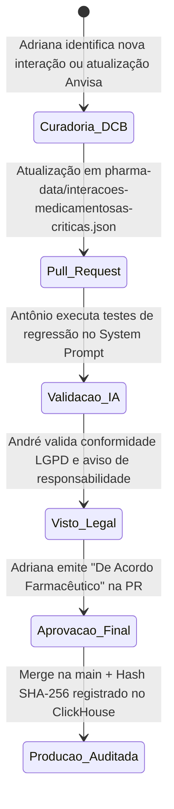

# 🏥 POP-001: Validação de Sistemas Computadorizados e Bases Farmacológicas para IA

## 1. Objetivo
Estabelecer a sistemática padronizada para **curadoria farmacológica, validação técnica, controle de versão e trilha de auditoria** das bases de dados de medicamentos e dos System Prompts utilizados pelos agentes de Inteligência Artificial da **Fratuci Labs**.

---

## 2. Alcance e Responsabilidades
Este POP aplica-se obrigatoriamente aos repositórios `strategy-and-healthtech`, `ai-agents-core` e `gcp-data-foundation`:
- **Responsável pela Curadoria Científica e Sanitária (Adriana):** Validar a nomenclatura oficial na **Denominação Comum Brasileira (DCB)**, classificar a severidade clínica das interações e aprovar as recomendações de manejo.
- **Responsável pela Conformidade Legal (André):** Garantir que o sistema exiba os avisos de isenção de prescrição médica e atenda ao direito de revisão humana (Art. 20 da LGPD).
- **Responsável pela Engenharia do Agente (Antônio):** Garantir que o modelo de IA utilize exclusivamente a base JSON homologada (RAG determinístico) sem extrapolações criativas (`temperature = 0.0` ou `0.1`).
- **Responsável pela Rastreabilidade de Dados (Anderson):** Garantir a gravação imutável do hash SHA-256 de cada consulta na tabela `fratuci_audit.healthtech_agent_events`.

---

## 3. Procedimento de Inclusão ou Alteração de Regra Farmacológica

### 3.1. Requisitos Obrigatórios do Registro Clínico
Nenhum medicamento ou interação pode ser inserido em [`pharma-data/interacoes-medicamentosas-criticas.json`](../pharma-data/interacoes-medicamentosas-criticas.json) sem conter todos os 8 campos estruturais obrigatórios do schema homologado:
1. `interaction_id`: Código único rastreável (`INT-DCB-XXX`);
2. `substance_a` e `substance_b`: Objetos contendo obrigatoriamente `dcb_name` (nomenclatura oficial **DCB/Anvisa**), `dci_name` (correspondente internacional **DCI/OMS**) e `therapeutic_class` (classe farmacológica);
3. `severity`: Classificação padronizada (`LEVE`, `MODERADA`, `ALTA`, `CONTRAINDICADA`);
4. `requires_human_pharmacist_signoff`: Booleano obrigatório (`true` para toda interação `ALTA` ou `CONTRAINDICADA`);
5. `pharmacological_mechanism`: Descrição clara da farmacocinética ou farmacodinâmica (ex: inibição de CYP3A4/CYP2D6, sinergismo anticoagulante);
6. `clinical_effect`: Desfecho clínico adverso esperado que justifica o alerta;
7. `recommended_conduct`: Orientação objetiva de manejo clínico/farmacêutico para o profissional de saúde;
8. `regulatory_source`: Fonte oficial de evidência (Bulário Eletrônico Anvisa, FTN/MS, Portaria SVS/MS 344/1998 ou diretriz clínica).

---

## 4. Trava de Segurança Clínica (*Hard Stop*)
> [!CAUTION]
> **REGRA INVIOLÁVEL DE SEGURANÇA DO PACIENTE:**  
> O sistema computadorizado da **Fratuci Labs** é classificado como ferramenta de **consulta e triagem documental**. É terminantemente proibido ao agente de IA sugerir dosagens personalizadas, substituir medicamentos sem supervisão ou emitir prescrição farmacêutica/médica autônoma.
